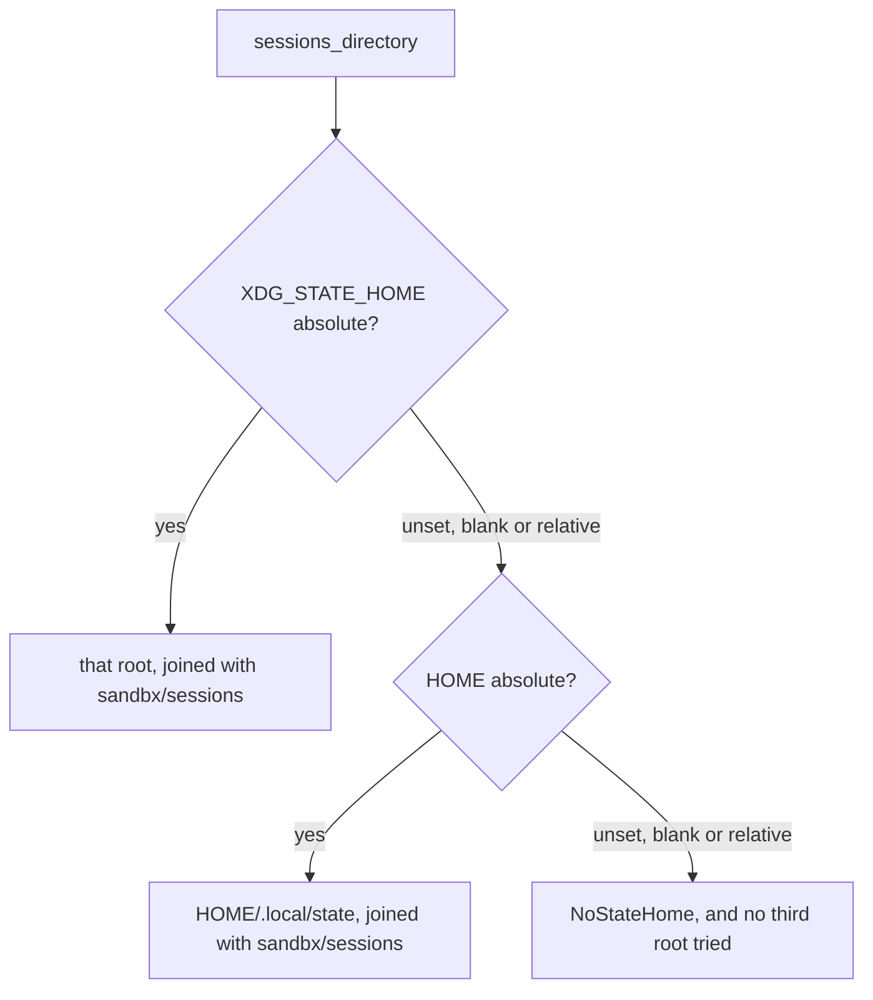
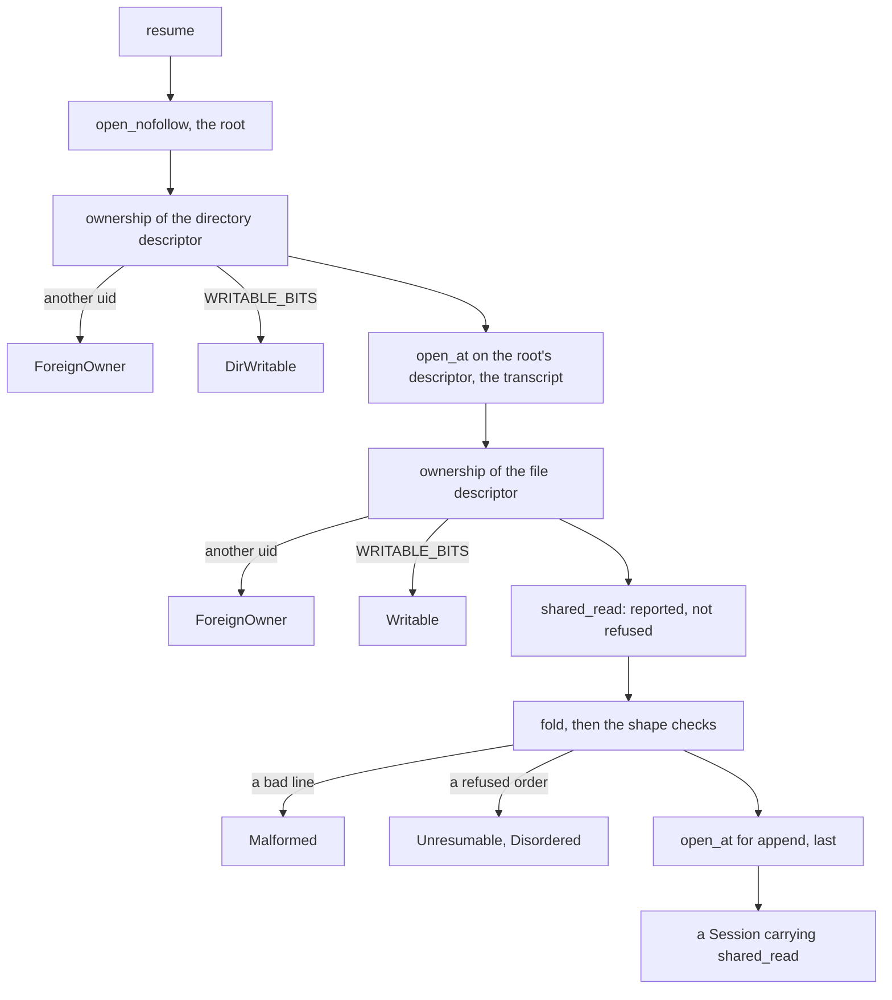

# sandbx-session-store writes the one thing that outlives the run

[04 — the architecture](04-the-architecture.md) closes its request path on one
clause: "the finished turn is appended to a session transcript as JSONL." This
crate owns that file. In 04's **View 2** it is the last box, reached once the
round loop has finished and the gate has gone quiet; in **View 1** it is not a
box, because nothing here spawns, forks or `exec`s — it opens files in the
harness process, and that is the whole of it.

A handful of source files under `src/`, with nearly as much test code again
under `tests/`; [guide-repo-map.md](../guide-repo-map.md) keeps the current file
list. Every internal dependency is elsewhere in the session tree: the shapes it
stores are `sandbx-session-message`'s, itself a leaf of
[05 — seven crates](05-seven-crates.md)'s graph; why an operation did not
happen is `sandbx-session-error`'s; and the name a transcript is filed under is
`sandbx-session-id`'s, a crate of its own since #360 and the only one of them
that depends on a sandbx crate itself. Three external ones: `nix` with only
`fs` and `user`, `serde`, `serde_json`, plus `tempfile` for the tests. The
reason to read it anyway is proportion. A transcript is the only plaintext copy
of a conversation sandbx keeps, it is replayed to a model that calls tools, and
[`SECURITY.md`](../../SECURITY.md) carries what that costs as a non-claim.

## The module tree

| file | what it holds | covered in |
|---|---|---|
| [`lib.rs`](../../crates/sandbx-session-store/src/lib.rs) | two re-exports and four private modules | — |
| [`sandbx-session-id`](../../crates/sandbx-session-id/src/lib.rs) | `SessionId`, `from_clock`, `clock_millis`, the allowlist — a crate of its own since #360 | [14](14-audit-sessions-credentials.md), then below |
| [`sandbx-session-paths`](../../crates/sandbx-session-paths/src/lib.rs) | `sessions_directory` — a crate of its own since #361 | [decision-on-disk-state.md](../decision-on-disk-state.md) |
| [`sandbx-session-message`](../../crates/sandbx-session-message/src/lib.rs) | `Message`, `Role`, `Content`, `Usage`, `CompletedTurn` — a crate of its own since #359 | [05](05-seven-crates.md), [24](24-crate-cli.md) |
| [`session.rs`](../../crates/sandbx-session-store/src/session.rs) | `SessionStore`, `Session`, the sequence `create` and `resume` run | below; the mode rule in [14](14-audit-sessions-credentials.md) |
| [`record.rs`](../../crates/sandbx-session-store/src/record.rs) | `Record`, `Header`, `Accounting`, `VERSION`, `fold` | [decision-on-disk-state.md](../decision-on-disk-state.md) |
| [`shape.rs`](../../crates/sandbx-session-store/src/shape.rs) | eight predicates over messages | [02](02-what-a-harness-is.md) for the API's rules |
| [`vet.rs`](../../crates/sandbx-session-store/src/vet.rs) | five mode constants, two opens, `ownership` | [11](11-the-two-seams.md) for the pattern, [14](14-audit-sessions-credentials.md) for the bits |
| [`sandbx-session-error`](../../crates/sandbx-session-error/src/lib.rs) | `SessionError`, seventeen variants — a crate of its own since #358 | below |
| `tests/` | `permissions`, `recovery`, `transcript`; `identifier` went with the id to `sandbx-session-id` | below |

`store.rs` left this table with #362: it was a `mod`-only shim re-exporting the
two names, and `lib.rs` already did that job, so the four modules are siblings
at `src/` and the shim is gone.

Two shapes to notice first. **`src/` has no subdirectory**, and the three
siblings of `session.rs` are `pub(super)` throughout — `Record`, `fold`, the
mode constants and every predicate are invisible outside the crate; at a crate
root `pub(super)` *is* `pub(crate)`, so what the token grants widened from
`store/` to the whole crate when the shim dissolved, with no visibility edit
anywhere and no item added to or removed from `public-api.txt`. The crate's
public surface is still the two names `lib.rs` re-exports, plus the three
`sandbx-session-message` types that `append`, `messages` and `observed` name in
their signatures, the `SessionError` that every fallible one of them returns,
and the `SessionId` that `Session::id` and `SessionStore::resume` name — none of
which the crate re-exports, so a consumer takes its own dependency to spell
them, as `sandbx-cli` does. And **the crate has no output channel**: no
`tracing` dependency, no `println!` or `eprintln!` under `src/`. That is not an
omission, it is what forces the design in the `session.rs` section.

## `sandbx-session-id` — an allowlist is three lines, and this is why

[14](14-audit-sessions-credentials.md) quotes the doc comment that states the
rule — "an allowlist, not a search for `..`". The code under it:

```rust
        if value.is_empty() {
            return Err(invalid("it is empty"));
        }
        // Bytes, not characters: the alphabet is ASCII, so a multi-byte string fails either way.
        if value.len() > MAX_LENGTH {
            return Err(invalid("it is longer than 32 characters"));
        }
        if !value.bytes().all(|byte| ALPHABET.contains(&byte)) {
            return Err(invalid(
                "a session id is 1 to 32 characters of 0-9 and a-z, and nothing else",
            ));
        }
```

`ALPHABET` is `b"0123456789abcdefghijklmnopqrstuvwxyz"`. Everything that is not
one of those thirty-six bytes is refused, and the `tests/identifier.rs` list is
the enumeration: fifteen values, each coming back as `InvalidIdentifier`
carrying the string that was offered, "quoted back so a typo is visible" — and
coming back with nothing on disk touched, `FromStr` being pure. That is the
whole of `a_traversing_id_is_refused_before_any_io`'s name: `../../etc/passwd`
is refused before the store's root is opened, so no path is ever built from it.
What each refusal buys, because the module doc only implies it:

| refused | what it would have reached |
|---|---|
| `..`, `../../etc/passwd` | `.` is outside the alphabet, so a traversal never has a character to start with |
| `/etc/passwd`, `a/b` | `transcript` names the file `format!("{id}.jsonl")` and `openat`s it on the root's descriptor, and `openat`, like `Path::join`, **ignores** the base for an absolute name — the transcript would be `/etc/passwd.jsonl` |
| `""` | the path would be `<root>/.jsonl`, a hidden file in the root, and `Display` would print nothing in the line that tells you what to pass `--session` |
| 33 characters | `MAX_LENGTH`'s doc says what the bound is for: it "bounds the path component a typo can build". Nothing about the clock needs it — `base36(u64::MAX)` is thirteen characters, pinned by a unit test |
| `UPPER` | on a case-insensitive filesystem `A` and `a` name one file while `SessionId` compares them as two, so `resume("A")` would read the transcript `create` wrote as `a` |
| `a-b`, `a.b`, `a_b`, `a b`, `a\0b`, `a\\b`, `~` | nothing in particular, and that is the point of an allowlist: no case had to be foreseen |

The last row is the argument. A denylist has to anticipate every interpreter —
the kernel's path parser, a shell, a filesystem's case folding, `chmod`'s
argument parser — and each is a list to keep complete forever. Thirty-six
characters is complete by construction, and `--session` takes its value straight
off argv.

Two more facts: `from_clock(attempt)` **adds** `attempt` to the millisecond
rather than suffixing it, so a retry after a collision is still one base36
number; and the type derives `Ord` while its doc says not to trust it, because
base36 gains a digit as the clock grows and the derived order sorts by length
first. Order a listing by the header's `created_at_millis`.

## `sandbx-session-paths` — two roots tried, and one never considered

```rust
    let absolute = |name| lookup(name).map(PathBuf::from).filter(|d| d.is_absolute());
    if let Some(dir) = absolute("XDG_STATE_HOME") {
        return Ok(dir.join(DIRECTORY));
    }
```

[decision-on-disk-state.md](../decision-on-disk-state.md) is the authority for
the roots. What the code adds is the shape of the test: one `absolute` closure,
applied to `XDG_STATE_HOME` and then to `HOME` before `.local/state` is joined
on. A blank variable fails it, because `PathBuf::from("")` is not absolute, and a
relative `$HOME` is `NoStateHome` rather than a guess.

The order, with the refusal standing where a third root would have gone:



The clause worth stopping on names no variable at all: nothing falls back to the
working directory. The function's doc says what that rules out — "a transcript
there would sit inside the tree a run can grant a tool write over, and the
history resumed from it is what the model is told it said." Neither half of that
hazard is enough alone: `sandbx-session-paths` keeps the store out of the
working tree, and `reaches_owned` in `sandbx-grants` refuses a grant that
reaches back in (#173) — see
[decision-policy.md](../decision-policy.md#what-the-harness-does-when-a-grant-covers-something-it-owns),
and [12](12-a-flag-to-a-kernel-rule.md) for the refusal.

**The lookup is injected** rather than read off the process: `set_var` is an
`unsafe fn` under edition 2024 and the workspace forbids `unsafe_code` in test
binaries too, so a test cannot drive a real environment. Two places hand
`std::env::var_os` to `sessions_directory`, both in production code:
`sandbx-session-bridge`'s `store`, whose doc says why — "this is the one place
that wants the real environment, and a test drives the store directly" — and
`sandbx-grants`' `flags.rs`, which passes the same lookup to `owned_paths` to
work out what a grant must be refused for reaching.

## `sandbx-session-message` — five types that are not the provider's

[05](05-seven-crates.md) argues why the stored shapes are declared rather than
imported. This is what the argument looks like at the type level. They are a
crate of their own since #359, which is also the reason this chapter covers them
beside the store that writes them: the file format and the file are read
together even though they no longer compile together.

`Message` is `{ role: Role, content: Vec<Content> }`; `Role` is `User` or
`Assistant` under `rename_all = "lowercase"`; `Content` is three variants under
`#[serde(tag = "type", rename_all = "snake_case")]` — `Text`, `ToolUse`,
`ToolResult` — which is [02](02-what-a-harness-is.md)'s
`tool_use`/`tool_result` vocabulary spelled a second time. `Usage` carries three
`Option<u32>` counts.

The pair worth holding side by side is the two enums' declarations. Here:

```rust
#[derive(Debug, Clone, PartialEq, Serialize, Deserialize)]
#[serde(tag = "type", rename_all = "snake_case")]
pub enum Content {
```

And in [`prompt.rs`](../../crates/sandbx-providers/src/prompt.rs):

```rust
#[derive(Debug, Clone, PartialEq)]
pub enum ContentBlock {
```

No `Serialize`, no `Deserialize`, no `tag`: the provider's block is not a wire
type at all. Its JSON is built by hand, in the `Blocks` and `BlockBody`
`Serialize` impls in
[`anthropic/body.rs`](../../crates/sandbx-providers/src/anthropic/body.rs). So
the file format lives on the type in *this* crate and nowhere else, and a vendor
respelling a block changes `body.rs` while a transcript keeps its shape.

The point is that `sandbx_providers::ContentBlock` has **five** variants: those
three plus `Thinking` and `RedactedThinking`. Nothing in the compiler's view
relates the two sets. What relates them is `sandbx-session-bridge`, whose crate
doc states the contract:

> The two block translations — `request_block` and `stored_block`, both private
> — destructure by field name with no `_` arm, so a sixth [`ContentBlock`]
> variant is a compile error here rather than a block silently missing from a
> saved conversation, and a fourth [`Content`] variant is the same in the other
> direction.

So the duplication buys a build failure at a known file. `stored_block` maps the
three shared variants and returns `None` for the two thinking kinds — see
[decision-thinking-replay.md](../decision-thinking-replay.md) — and
`request_history` maps back; [24 — the cli crate](24-crate-cli.md) covers that
seam. The correspondence is kept by hand, enforced only by the translation
ceasing to compile when it drifts.

Two details this file owns. `is_error` is
`#[serde(default, skip_serializing_if = "Option::is_none")]`, so a successful
call's line carries no `is_error` key rather than a `null`, with
`an_absent_is_error_reads_back_as_none` pinning both directions. And
`CompletedTurn<'a>` — the crate's only borrowing type, and `Copy` — bundles
`messages: &'a [Message]`, `observed: Option<Usage>` and `withheld: usize`, the
last an index into the history its doc calls "exact only because a transcript is
appended to". `append` takes one by value, so a caller cannot write messages
without the accounting that describes them, or accounting without its messages.

## `session.rs` — which bit refuses, and which only reports

`vet.rs`'s module doc draws the division: "Which mode bit refuses and which
only reports stays with the sequence that applies it." `vet.rs` *names* the mode
bits and never acts on them. Besides the symlink refusal its opens make, the one
rule it applies itself is the owner's, which is the same at every site, so
`ownership` refuses another uid as `ForeignOwner` before it hands back a mode. `resume` acts on the mode:

```rust
        let mode = ownership(&file, &path)?;
        if mode & WRITABLE_BITS != 0 {
            return Err(SessionError::Writable { path, mode });
        }
```

One mode, read once, two things done with it: this arm, and the line after,
`let shared_read = mode & READABLE_BITS != 0;`. The directory twin sits above
it, `DirWritable` for `Writable`, going first because a writable directory makes
the file's mode irrelevant — [14](14-audit-sessions-credentials.md) has the
asymmetry and the `0700`/`0600` family it belongs to.

Follow the sequence down, and the refusals out of the side of it:



What is at the signature level is **where each verdict goes**. A refusal is an
`Err`, so it ends the call. A report has nowhere to go — the crate cannot print
and cannot log — so it becomes the last field of the `Ok`:
`Session { id, path, file, messages, observed, withheld, shared_read }`.

Every field private, seven read-only accessors, one `&mut self` mutator in
`append`, and no `Session::new`: the only ways to hold one are
`SessionStore::create` and `SessionStore::resume`, and both vet before they
construct. This is [11](11-the-two-seams.md)'s shape for `FsGuard`'s handles —
the value *is* the capability — and it sticks because `Session` holds an open
`File` and derives no `Clone`. `SessionStore` is `{ root: PathBuf }`, `Clone`,
and holds no descriptor: a directory you have named rather than been let into.
`transcript` is private, so only a `SessionId` can build a path — and since
#360 the field that `SessionId` wraps is private in a crate of its own, so no
code here can forge one either.

Printing the report is `sandbx-cli`'s work, and `session::open` is the single
place it happens — reached by both `agent/run.rs` and `agent/tui.rs`, so the
stderr note cannot be on one surface and missing on the other.

Three more things `session.rs` decides:

- **`O_EXCL` is what makes an id unique**, not a prior existence check. The
  loop tries `ATTEMPTS` ids, treating `AlreadyExists` as "try the next
  millisecond" and everything else as `Io`; exhausting it is
  `SessionError::Collision`, whose message says the clock is not advancing.
- **The reopen for append happens last**, after `fold` and the shape checks, so a
  transcript that will be refused is never opened for writing.
- **`write` builds one `String` and does one `write_all`**, which is why a torn
  file can only be torn at the end. There is no `fsync`: the guarantee is about
  *where* a partial write lands, not about a completed append surviving power
  loss.

## `record.rs` — three line kinds, and the fold

An append-only log plus a fold is the whole persistence model.

```rust
pub(super) enum Record {
    Header(Header),
    Message(Message),
    Turn(Accounting),
}
```

Internally tagged, so a message line is the message's own fields plus a `type`.
What one line looks like, verbatim from the value
`a_message_line_is_the_message_plus_a_type` asserts:

```rust
            serde_json::json!({
                "type": "message",
                "role": "user",
                "content": [{ "type": "text", "text": "what is in /srv?" }],
            })
```

A `header` carries `version`, `id` and `created_at_millis`; a `turn` carries
`observed` and `withheld`, so one exchange of prose is **four lines** — header,
message, message, turn. Read that off
`an_unparsable_line_names_the_line_it_is_on`, where a fifth line appended by
hand is reported as `line: 5`.

Replaying N lines produces exactly three things: the `Vec<Message>` in file
order, the last `observed` any `turn` line reported, and the last `withheld`.
The fold is `observed = accounting.observed.or(observed)` and
`withheld = accounting.withheld`, which is what the turn loop does in memory, so
a resumed conversation and a continued one carry the same numbers;
[decision-on-disk-state.md](../decision-on-disk-state.md) explains why figures
nothing reads today are written at all.

Two things are checked per line, and only one of them cares where the line sits.
The version is read off *every* header, ahead of the match; the match then
decides what is genuinely position-specific, which is why it takes the pair
`(index, record)` rather than the record alone:

```rust
        // Ahead of the match, so it reads every header and not only line 0's: a later one
        // declaring a version this build cannot read is a file it cannot replay.
        if let Record::Header(header) = &record
            && header.version != VERSION
        {
            return Err(SessionError::UnsupportedVersion {
                path,
                version: header.version,
            });
        }

        match (index, record) {
            (0, Record::Header(_)) => headed = true,
            // ... the other arms, elided; a second header reaches the last and is skipped
```

The version test is `!=`, not `>`, so any header this build does not write is
refused rather than read on a best effort —
`a_future_version_is_refused_not_guessed` pins a `2` — and the variant's own doc
gives the reason: "refused, since best-effort would drop a field and so change
the history the model is shown". Reading it off every header rather than off
line 0 is what makes that hold for a file somebody concatenated or edited by
hand: a `version: 1` line 0 followed by a `version: 2` header and v2 content is
a file this reader cannot replay whatever the first line said, and
`a_later_header_is_read_for_its_version_too` drives exactly that pair, with both
versions as literals so a `VERSION` bump fails the test rather than passing
unread. What the later arm still skips is everything *else* a second header
carries, which really is nothing the replay uses.

Position decides the other refusal: anything but a header on line 0 is
`MissingHeader`, and so is a file whose only line was a torn one, which is what
`headed` is for.

An undeclared *field* is the third case and the lenient one: an extra key on a
stored line reads back without it, which
`an_unknown_field_is_ignored_rather_than_refused` in `sandbx-session-message`
pins with a `thinking_signature` beside the message and a `citations` inside a
text block. An unknown record `type` fails the parse instead —
[decision-on-disk-state.md](../decision-on-disk-state.md) grades the three, and
[14](14-audit-sessions-credentials.md) has the `type` half.

### What a damaged tail actually does

The rule is narrower than "a truncated file is tolerated". It is three
conditions, decided above the loop in `fold` and pinned by `tests/recovery.rs`:

```rust
    let torn = !body.ends_with('\n');
    let last = body.lines().count().saturating_sub(1);

    for (index, text) in body.lines().enumerate() {
        let record: Record = match serde_json::from_str(text) {
            Ok(record) => record,
            Err(_) if torn && index == last => break,
```

Three conditions must hold together for a line to be dropped: the file does not
end in a newline, it is the final line, **and** it fails to parse. So a write
cut exactly at a record boundary minus its newline is still replayed — the line
parses, and nothing throws it away.

| what was done to the file | what `resume` does |
|---|---|
| a partial record appended with no newline | drops it; `a_torn_final_line_is_dropped` asserts the earlier messages come back whole |
| the file replaced by one partial line | `MissingHeader` — nothing is left to replay, so the header was never read |
| a bad line *with* a newline after it | `Malformed`, carrying the one-based line number and `serde_json`'s own error as `source` |
| an interior pair of user turns inserted | `Disordered`, caught by the whole-history check and not by anything in `fold` |
| a second header spliced in, declaring another version | `UnsupportedVersion`, the check sitting ahead of the match so it sees every header |
| a `turn` line and no messages at all | resumes; the figure survives, which is the only place a blockless round's usage can live |

Read that table alongside what the shape checks do, because they share one
premise: **the read path assumes a transcript may have been edited.** That is
why the ordering predicates run over the whole history rather than its end, and
it is the same reason the version is read off every header — a file is not taken
to be internally consistent just because its first line was well-formed.

## `shape.rs` — eight predicates and no I/O

Its module doc draws the boundary: "these answer to the Messages API's rules
about a request, `session.rs` to the filesystem's about a file. Every one is a
predicate over messages alone — no path, no mode, no descriptor." Why a stored
file needs an API rule checked against it at all: a transcript is replayed as
the history of the next request, so an order the API rejects is not a corrupt
file, it is a **400 on the next turn** — a session that exited zero and can
never be resumed. The case in point is the pairing rule
[02](02-what-a-harness-is.md) sets out: a `tool_use` with no `tool_result`
answering it is a conversation the API will not take back.

| predicate | visibility | true when |
|---|---|---|
| `alternating` | `pub(super)` | every neighbouring pair `joins` |
| `opens` | `pub(super)` | the first role is not `Assistant`; an empty history is true |
| `follows` | `pub(super)` | a batch's first message `joins` the stored last, falling back to `opens` on an empty store |
| `resumable` | `pub(super)` | `settled`, or ending on a turn that is `answers_only` |
| `answers_only` | `pub(super)` | non-empty content, every block a `ToolResult` |
| `settled` | private | the last role is `Assistant`; an empty history is **not** settled |
| `joins` | private | the roles differ, or the legal `user, user` pair |
| `asks_only` | private | non-empty content with no `ToolResult` in it |

The relaxation for a turn that ran out of rounds (#188) lives entirely in
`joins`:

```rust
fn joins(earlier: &Message, later: &Message) -> bool {
    earlier.role != later.role
        || (earlier.role == Role::User && answers_only(earlier) && asks_only(later))
}
```

Tight at both ends, and `asks_only`'s doc gives the reason: the merge in
`sandbx-cli` concatenates the pair's blocks, so a later turn carrying results of
its own would send one naming a call no earlier message made —
[decision-on-disk-state.md](../decision-on-disk-state.md) has the full argument.

Where they are applied matters, because the call sites use different sets:

| site | predicates | refuses as | the one it cannot use |
|---|---|---|---|
| `SessionStore::resume` | `resumable`, `alternating`, `opens` | `Unresumable`, then `Disordered` | `follows` — there is no batch |
| `Session::append` | `resumable`, `alternating`, `follows` | `IncompleteTurn`, then `DisorderedTurn` | `opens`, subsumed by `follows`'s empty-store arm |
| `Session::pending_call` | `answers_only` on the last message | nothing — it returns a `bool` | — |

Neither guard asks any of them about an empty history: both sit behind
`if !messages.is_empty()`, which is what lets
`a_new_session_resumes_before_it_has_said_anything` resume a transcript that is
a header and nothing else, where `resumable(&[])` is false.

Both guards take the relaxation, which `shape.rs` says is not a choice: `append`
writing a shape `resume` refuses is a session nothing can undo. And all of it is
**shape, not provenance** — no `tool_use_id` is matched against the call it
claims to answer — which costs one diagnosis, stated in the decision record and
tracked as #226: an append torn after its `tool_result` line reads as a round
limit, and `session::open` tells the *model* its last turn ran out of rounds.

## `vet.rs` — the mode comes off the descriptor

This is [11 — the two seams](11-the-two-seams.md)'s pattern applied a second
time: there, `confirm` takes its measurement through an `O_PATH` descriptor
because "the `fstat` goes through the descriptor rather than the name, which is
the one measurement a rename cannot step between." Here:

```rust
pub(super) fn ownership(file: &File, path: &Path) -> Result<u32, SessionError> {
```

`&File`, so there is no overload that takes a path: `File::metadata` is `fstat`,
and the only way to call it is to already hold the thing you are about to read.
The `path` argument is for the error message. A uid other than both `geteuid()` and `getuid()`
returns `ForeignOwner` before any mode leaves the function; otherwise it returns
`metadata.permissions().mode() & 0o7777`, masked for the reason the line above it
gives:

> Masked to the permission bits: the raw mode carries the file type too, which
> no message should print as part of an octal mode.

Three ways this differs from 11:

- **There is no object identity to confirm, because there is no second
  process.** 11's seam hands a grant across an `exec` to a helper that opens it
  again, which is what makes `ObjectId` necessary. Here the vetted descriptor
  and the one read are the same value in the same function.
- **The transcript is opened by name in a directory, never by path.** Every
  transcript open — the create, the read, the reopen for append — is `open_at`,
  an `openat` on the root's vetted descriptor with `O_NOFOLLOW` each time, so
  the directory vetted is the directory the name is looked up in (#317):

  > Through the descriptor, not the path: a rename of the root or an ancestor
  > after the vet would leave one directory checked and another read (#317).

- **A mode is sometimes narrowed rather than refused**, which has no counterpart
  in `fs_guard.rs`. `narrow_root` `fchmod`s the descriptor it just stat'd —
  `set_permissions` on the `File`, not `std::fs::set_permissions` on the path —
  "so the directory narrowed is the one vetted", and
  `a_symlinked_root_is_refused_not_narrowed` asserts the negative by checking
  the link's target still reads `0o755` afterwards.

Five constants: `OWNER_ONLY` `0o600`, `DIR_OWNER_ONLY` `0o700`, `WRITABLE_BITS`
`0o022`, `READABLE_BITS` `0o044`, and the one not in
[14](14-audit-sessions-credentials.md)'s table, `DIR_SHARED_BITS` `0o077` —
wider than the other two, with its own reason:

> Wider than [`WRITABLE_BITS`]: a transcript's name is clock-derived and so
> guessable, and group/other execute alone lets somebody else traverse to it.

The absence of `O_DIRECTORY` on `open_nofollow` is deliberate, and
[decision-on-disk-state.md](../decision-on-disk-state.md) owns the reasoning:
paired with `O_NOFOLLOW` the kernel reports a symlinked directory as `ENOTDIR`,
which is what a root that is a plain file reports too, so the flag would merge
two refusals worth telling apart. `ELOOP` is matched by raw errno, not the
unstable `ErrorKind::FilesystemLoop`.

One limit: the checks are on the root, not its ancestors — `O_NOFOLLOW` covers
the last component only, and nothing vets `~/.local/state`. What makes that
enough is the root's own pair, and that every transcript is reached through the
descriptor the pair was checked on: another user replacing `sessions/` can only
put their own directory there, `ForeignOwner`, or a link, `Symlink`, and a
replacement after the check is never the directory a transcript is opened in.

- **Worth questioning:** the create path *repairs* a wide root, where
  [14](14-audit-sessions-credentials.md) makes "refused, never repaired" the
  principle of this area — "the mode is evidence, and repairing it destroys the
  evidence while leaving the exposure."
  [decision-on-disk-state.md](../decision-on-disk-state.md) answers for the
  narrowing with "at create time the directory holds nothing a refusal would
  protect", which is sound about the session being created and silent about the
  directory's existing contents: a `sessions/` found at `0o777` may have held
  every earlier transcript while it was wide, and `narrow_root` returns `()`, so
  nothing records that it was. The asymmetry is sharpest against the transcript
  rule one bit away — a merely *readable* transcript resumes and sets
  `shared_read`, precisely so the operator hears about a disclosure that cannot
  be undone, while a wide root is the same class of event and gets no field. The
  mechanism costs a `bool`; the refusal the record rejects is not the only
  alternative to silence.

## `sandbx-session-error` — seventeen variants, and the two kinds

A crate of its own since #358, and the bottom of the session tree: every
fallible path in this chapter returns it, and it names no sandbx crate itself,
so nothing above it can be reached from here. The crate doc opens with a rule:
"No `From` impls, and do not add one: every wrapped failure is paired with the
path and operation it came from, which a blanket conversion would discard."
Ten of the seventeen carry a `PathBuf`, which is what that rule protects. The
split worth holding is between a **refusal** — sandbx decided not to — and a
**host failure**, where the machine could not:

| kind | variants |
|---|---|
| refusal, about what was asked | `InvalidIdentifier`, `NotFound` |
| refusal, about what is on disk | `MissingHeader`, `UnsupportedVersion`, `Malformed`, `Writable`, `DirWritable`, `Symlink`, `ForeignOwner`, `Disordered`, `Unresumable` |
| refusal, about a shape no later resume would accept | `IncompleteTurn`, `DisorderedTurn` |
| host failure | `NoStateHome`, `Clock`, `Collision`, `Io` |

Two things follow from the table rather than from the file. **The last two rows
are the same two shapes refused from two sides, and the enum splits rather than
shares.** A history ending on a prompt nothing answered is `Unresumable` coming
off disk and `IncompleteTurn` going in; one out of order is `Disordered` coming
off disk and `DisorderedTurn` going in. The read-side pair carries a `PathBuf`
and the write-side pair carries nothing at all, which is not an oversight but
where the defect is: `append` rejects the *argument*, and the transcript on disk
is still correct, so there is no file to blame — while a refused resume is about
a file and nothing else, and an operator with several sessions needs to be told
which one to open. `a_transcript_ending_on_a_user_turn_is_refused` asserts the
path and not just the variant, for that reason. The cost of sharing one variant
instead is worth seeing, because `sandbx-cli` reads these from the other side:
`agent/run.rs` special-cases `IncompleteTurn` on the append path as not an
error at all, printing "the turn produced nothing to store" and returning `Ok`.
That is right for an append and would be wrong for a resume, and under one
variant the two were told apart only by which call site the match sat on.

And **`source` returns `Some` for two variants only**, `Malformed` and `Io`, the
two that wrap a foreign error, with the remaining fifteen listed by name in one
arm so a new variant does not compile until somebody has decided whether it has
a cause. `Malformed` exposing `serde_json`'s message is a deliberate difference
from the credential path; [14](14-audit-sessions-credentials.md) has why.

Two messages end in the command to type — `chmod 600`, `chmod 700` — while
`NotFound`, `Collision` and `Clock` name the condition, there being no fix to
name: the habit [01](01-what-sandbx-is.md) notes about the policy refusals.

Worth noticing what the records do and do not settle here.
[decision-on-disk-state.md](../decision-on-disk-state.md) is the authority on
what `resume` must *check*, and says nothing at all about what it reports when a
check fails. The wording and the split are therefore the enum's own business,
governed by nothing but the rule in the crate doc — which is a useful thing to
know about this repo: a decision record binds the mechanism, not every
consequence of it.

## Where the tests are

Unit tests sit in `record.rs`, and next door in `sandbx-session-paths`,
`sandbx-session-id` and `sandbx-session-message` — the places that are pure
functions over values. `session.rs`, `vet.rs` and `shape.rs` have none, needing
a real filesystem or the store that drives them;
[guide-testing.md](../guide-testing.md) governs the split.

| target | what it pins |
|---|---|
| `permissions` | what `create` creates, what `resume` refuses, and both symlink arms |
| `recovery` | a damaged file: the torn tail, the interior pair, the blockless turn |
| `transcript` | the format's own rules — round trips, the `#188` relaxation, versions, ordering |

`identifier` was a fourth row here until #360 gave the id a crate of its own,
and it moved with the code it pins: the refusal list above and a text round
trip are now `sandbx-session-id`'s only integration target.

The suite is honest about its two limits. `permissions.rs` says one outright: "A
foreign owner is refused too, but no test here drives that arm, which needs a
second uid." And `a_new_transcript_is_unwritable_to_others` asserts
`mode & 0o077 == 0` rather than `mode == 0o600`, because `OpenOptionsExt::mode`
is masked by the umask, which can only clear bits.

## You should now be able to explain

- Why a `SessionId` is an allowlist rather than a check for `..`, and what each
  of `/`, a leading `-`, an empty string and an uppercase letter would have
  reached if it were not.
- What `sessions_directory` never considers, and which other crate closes the
  same hazard from the other direction.
- Why `Content` has three variants where `ContentBlock` has five, which of the
  two carries the serde attributes, and which file stops compiling when a sixth
  arrives.
- What "which bit refuses and which reports" means at the signature level: an
  `Err` for one, a private field inside the `Ok` for the other, why the crate
  has no third option, and what holding a `Session` at all is evidence of.
- What one line of a transcript looks like, how many lines one exchange of prose
  writes, and the three conditions that must hold together for `fold` to drop
  one.
- Which of `fold`'s checks depends on a line's position and which does not, why
  the version is read off every header, and how an unknown field, an unknown
  record `type` and an unknown version are each answered differently.
- Which two shapes `SessionError` refuses from both sides, why each side gets
  its own variant, and which side carries a path.
- Why a file format needs a check about the Messages API in it at all, and which
  single pair of user turns is legal.
- Why `ownership` takes a `&File` and not a `&Path`, and what is different here
  from the seam in [11](11-the-two-seams.md).

## Next

[23 — the tui crates](23-crate-tui.md): the screen one turn is drawn on, the
events it folds, and the keys that stop it. Where this crate's output is a file
nobody watches, that one's is a surface somebody reads as it is written — and
since #365 it borrows the vocabulary from a leaf crate rather than from the one
that opens the stream, which makes its independence the same kind as this
crate's rather than the nearest thing to it.
